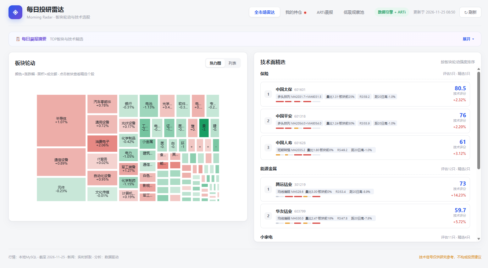
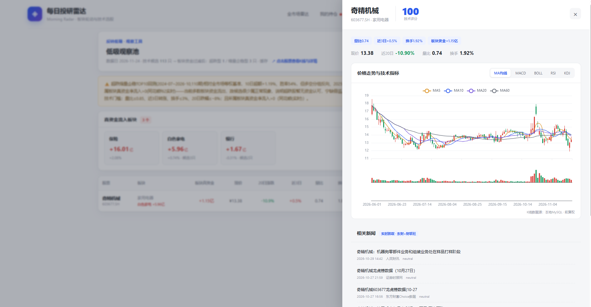
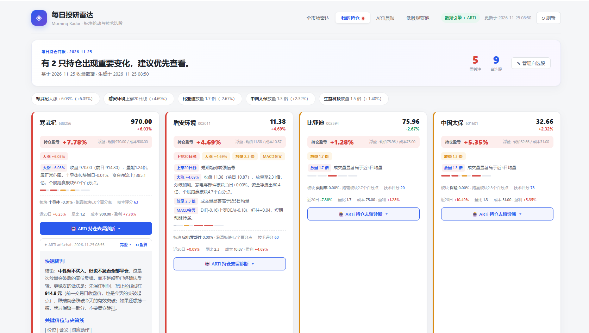
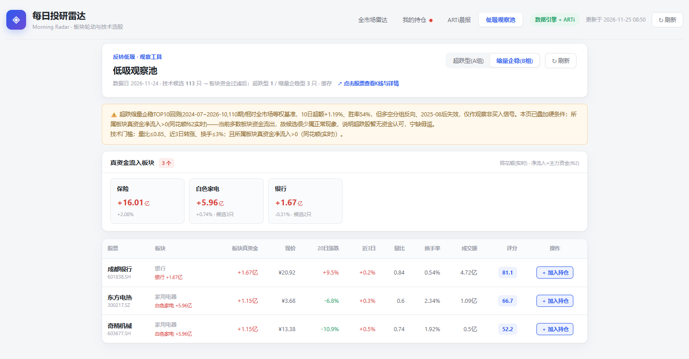
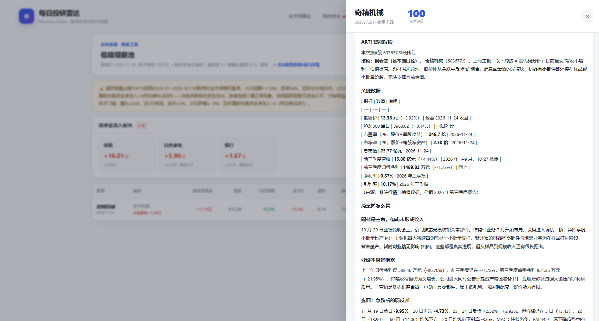

# 📡 Morning Radar - A股晨间投研终端

> A morning research terminal for A-share investors: sector rotation, technical screening, real-time news analysis, and dip-watching pool. Local MySQL-first, data-driven and interpretable.

[](LICENSE)
[](https://www.python.org)
[](https://fastapi.tiangolo.com)

##  项目简介

**Morning Radar** 是一个面向活跃个人投资者和量化研究者的晨间投研终端。每天早上打开一个页面,10秒看懂持仓异动和盈亏,再看板块轮动与技术精选,翻一眼低吸观察池和官方晨报。

### 核心特色

-  **本地优先**: 行情来自本地 MySQL 库(500万+日线,130个申万板块),零外网依赖
- 📊 **数据驱动**: 每条分析结论都引用真实指标数值或新闻标题,不输出空泛套话
- 🔍 **可解释选股**: 每只股票附带技术信号和五维评分,不是黑箱
- ⚡ **实时新闻**: 东财快讯+财联社电报,每15分钟自动刷新
-  **四大视图**: 全市场雷达 / 我的持仓 / ARTi晨报 / 低吸观察池

## 📸 界面预览

### 全市场雷达 - 板块轮动热力图


### 个股K线 - 5种技术指标一键切换


### 持仓异动提醒 - 10秒看懂盈亏


### 低吸观察池 - 超跌+缩量+资金硬过滤


### ARTi智能解读 - 数据驱动四维分析


##  快速开始

```bash
# 安装依赖
pip install -r requirements.txt

# 启动服务
python -m uvicorn web.app:app --host 127.0.0.1 --port 8766

# 浏览器访问
# http://127.0.0.1:8766
```

详细文档请查看 [完整 README](README.md)

## 📦 核心功能

| 功能 | 说明 |
|------|------|
| **板块轮动** | Treemap热力图,涨幅+资金净流入综合评分 |
| **技术选股** | 五维加权评分(趋势/动量/量能/位置/超跌) |
| **K线分析** | 前复权日K,5种指标一键切换(MA/MACD/BOLL/RSI/KDJ) K线数据从本地数据库中获取 |
| **实时新闻** | 东财724快讯+财联社电报,数据驱动四维分析 |
| **持仓简报** | 异动检测+盈亏分析+ARTi持仓诊断 |
| **低吸观察池** | 超跌+缩量企稳+板块真资金流入硬过滤 |
| **ARTi晨报** | 官方早晚报,完整HTML呈现 |

## 🏗️ 技术架构

- **后端**: FastAPI + Uvicorn
- **数据源**: 本地 MySQL (优先) / 同花顺实时 / Akshare (降级)
- **前端**: 原生 HTML/CSS/JS + ECharts
- **缓存**: SQLite 分层缓存(行情/新闻/分析/低吸池)
- **AI增强**: ARTi API (可选,不配Key也能完整运行)


## ️ 合规声明

本项目仅用于技术演示与研究学习。**不构成任何投资建议**。所有技术信号、AI 分析内容均为公开信息加工结果,低吸观察池是观察工具而非买入信号。股市有风险,决策与责任在投资者本人。

## 📄 License

MIT
